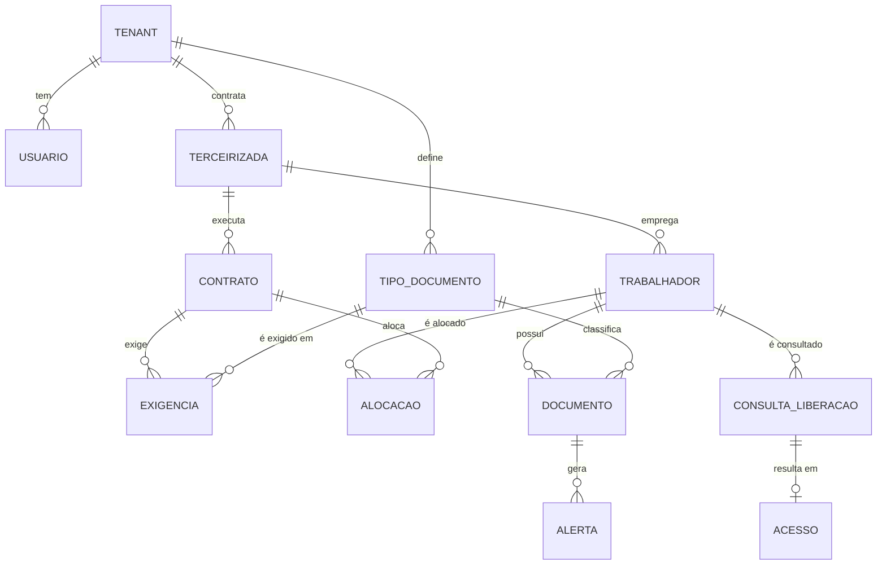
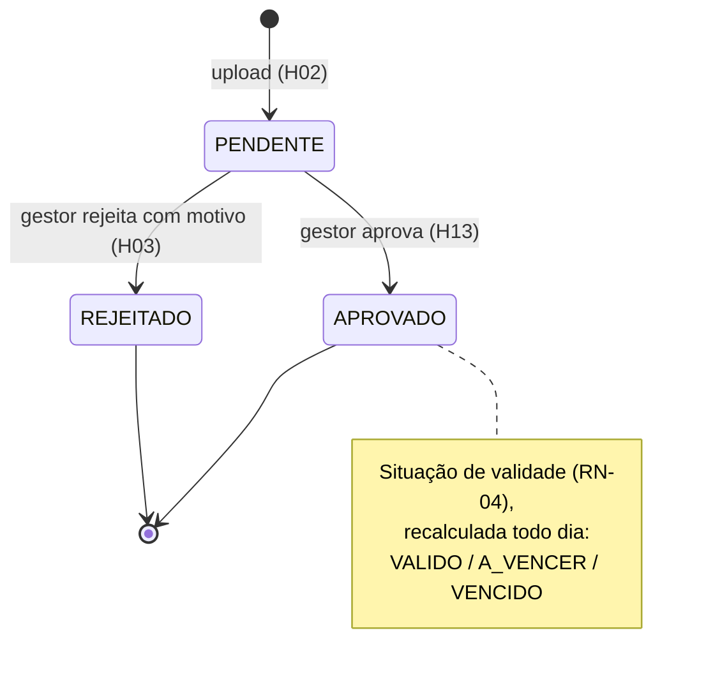

# Modelo de dados e tenants

| Campo | Valor |
|---|---|
| Status | Rascunho |
| Responsável | Tech Lead (regras de negócio validadas pelo PO) |
| Última atualização | 14/10/2026 |
| Decisões relacionadas | [ADR 0002](adr/0002-tenant-autorizacao.md), [ADR 0006](adr/0006-armazenamento-de-documentos.md), [ADR 0007](adr/0007-recalculo-idempotente.md), [ADR 0008](adr/0008-consulta-liberacao-cpf.md), [ADR 0009](adr/0009-auditoria-append-only.md) |

## Modelo de domínio



**Ponto central do design:** o **documento pertence ao trabalhador**, não ao contrato. O contrato apenas declara quais tipos exige. É isso que torna o reuso entre contratos (RN-08) automático, sem cópia de arquivo.

## Entidades

| Entidade | Descrição | Campos principais |
|---|---|---|
| **Tenant** | Empresa contratante (cliente) | `id`, `nome`, `criadoEm` |
| **Usuário** | Login no Firebase Auth com claims | `uid`, `tenantId`, `papel` (`gestor`, `terceirizada`, `porteiro`), `terceirizadaId` (só para papel `terceirizada`) |
| **Terceirizada** | Prestadora contratada pelo tenant | `id`, `cnpj`, `razaoSocial`, `ativa` |
| **TipoDocumento** | Catálogo do tenant | `id`, `nome`, `validadeMeses` (prazo padrão, usado para sugerir e conferir a validade) |
| **Contrato** | Vínculo tenant–terceirizada | `id`, `terceirizadaId`, `identificador`, `dataInicio`, `dataFim`, `exigencias[]` (ids de TipoDocumento), `versaoMatriz` |
| **Trabalhador** | Pessoa da terceirizada | `id`, `terceirizadaId`, `nome`, `cpfHash`, `cpfMascarado`, `ativo` |
| **Alocação** | Trabalhador em um contrato | `contratoId`, `trabalhadorId`, `semaforo`, `pendencias[]`, `calculadoEm` |
| **Documento** | Arquivo de SST de um trabalhador | `id`, `trabalhadorId`, `tipoDocumentoId`, `dataEmissao`, `validoAte`, `statusRevisao`, `situacaoValidade`, `motivoRejeicao`, `arquivo` (`caminho`, `contentType`, `tamanhoBytes`, `sha256`), `enviadoPor`, `revisadoPor`, `revisadoEm` |
| **Alerta** | Aviso de vencimento | `id` determinístico, `documentoId`, `tipo` (`VENCE_EM_30_DIAS`, `VENCIDO`), `criadoEm`, `lidoEm` |
| **ConsultaLiberacao** | Consulta feita pela portaria | `id`, `trabalhadorId` (ou nulo), `resultado`, `porteiroUid`, `criadaEm`, `usadaEm` |
| **Acesso** | Entrada ou barramento registrado | `id`, `consultaId`, `decisao` (`ENTRADA`, `BARRADO`), `porteiroUid`, `registradoEm` |
| **RegistroAuditoria** | Evento imutável | `id`, `ator`, `papel`, `acao`, `recurso`, `detalhes`, `dataHora`, `requestId` |

## Coleções no Firestore

Todo dado de negócio vive sob `tenants/{tenantId}` ([ADR 0002](adr/0002-tenant-autorizacao.md)).

```
tenants/{tenantId}
├── terceirizadas/{terceirizadaId}
├── tiposDocumento/{tipoDocumentoId}
├── contratos/{contratoId}
│   └── alocacoes/{trabalhadorId}          ← semáforo materializado por contrato
├── trabalhadores/{trabalhadorId}
│   └── documentos/{documentoId}
├── indiceCpf/{cpfHash}                    ← { trabalhadorId }  garante unicidade e busca O(1)
├── alertas/{documentoId_tipo}             ← ID determinístico (idempotência)
├── consultasLiberacao/{consultaId}
├── acessos/{acessoId}
└── auditoria/{registroId}                 ← append-only
execucoesJob/{dataReferencia}              ← controle do job diário (fora dos tenants)
```

**Arquivos** no Cloud Storage (bucket privado):
`tenants/{tenantId}/trabalhadores/{trabalhadorId}/documentos/{documentoId}/{uuid}.{pdf|jpg|png}`

### Índices previstos

| Consulta | Coleção | Campos |
|---|---|---|
| Fila de pendentes (H12) | `documentos` (collection group, filtrada por tenant no caminho) | `statusRevisao` ASC, `enviadoEm` ASC |
| Alertas não lidos (H05) | `alertas` | `lidoEm` ASC, `criadoEm` DESC |
| Trilha por período (H21) | `auditoria` | `acao` ASC, `dataHora` DESC |
| Documentos a recalcular (H15) | `documentos` (collection group) | `statusRevisao` ASC, `validoAte` ASC |

> Consultas de *collection group* atravessam tenants por natureza. **Regra:** só o job interno pode usá-las sem filtro de tenant; toda rota de usuário filtra por `tenantId` da claim. Isso é verificado em revisão de código e em teste de isolamento.

## Ciclo de vida do documento

O documento tem dois eixos independentes: **revisão** (decisão humana) e **validade** (cálculo por data).



Estados de revisão são **finais**: aprovado ou rejeitado não volta para pendente. Corrigir significa enviar um novo documento (H14), preservando o histórico.

## Regras de negócio

| ID | Regra |
|---|---|
| **RN-01** | Todo dado pertence a exatamente um tenant. O `tenantId` vem sempre da claim do token, nunca da requisição. |
| **RN-02** | Um usuário `terceirizada` só enxerga e altera trabalhadores, documentos e contratos da sua própria `terceirizadaId`. |
| **RN-03** | Rejeição exige motivo com 10 a 500 caracteres após remover espaços nas pontas. |
| **RN-04** | **Faixas de validade.** `dias = validoAte − dataReferência`, em dias corridos, no fuso `America/Sao_Paulo`. Se `dias < 0` → `VENCIDO`; se `0 ≤ dias ≤ 30` → `A_VENCER`; se `dias > 30` → `VALIDO`. O documento vale até o fim do dia `validoAte`. |
| **RN-05** | **Documento que atende uma exigência.** Para cada tipo exigido, considera-se o documento `APROVADO` do trabalhador, daquele tipo, com o maior `validoAte`. Documentos `PENDENTE` e `REJEITADO` não atendem exigência. |
| **RN-06** | **Semáforo trabalhador × contrato.** **Vermelho** se alguma exigência não tem documento que a atenda (RN-05) ou se esse documento está `VENCIDO`. **Amarelo** se todas são atendidas e ao menos uma está `A_VENCER`. **Verde** se todas estão `VALIDO`. Um documento rejeitado não anula outro aprovado e válido do mesmo tipo (questão Q1 em aberto na Visão e Escopo). |
| **RN-07** | **Semáforo do contrato** = pior cor entre os trabalhadores alocados ativos, acompanhado da contagem por cor. Contrato sem trabalhadores mostra "sem trabalhadores", sem cor. |
| **RN-08** | **Reuso.** Um documento aprovado atende a exigência do mesmo tipo em qualquer contrato do **mesmo tenant**. O reuso nunca atravessa tenants. |
| **RN-09** | **Data de validade (RF03).** A terceirizada informa `validoAte` (obrigatória) e `dataEmissao` (opcional) ao enviar o documento. Regras: `dataEmissao` não pode estar no futuro; `validoAte` não pode ser anterior a `dataEmissao`. Na aprovação, o gestor confere e pode corrigir `validoAte`. O `validadeMeses` do tipo serve para sugerir a data na tela (`dataEmissao + validadeMeses`) e para sinalizar ao gestor quando a validade informada ultrapassa o padrão do tipo. |
| **RN-10** | **Liberação na portaria.** `LIBERADO` se o trabalhador está ativo e tem semáforo verde ou amarelo em ao menos um contrato **vigente** (`dataInicio ≤ hoje ≤ dataFim`). `BLOQUEADO` se está cadastrado mas não cumpre a regra. `NAO_CADASTRADO` se o CPF não existe no tenant (questão Q2 em aberto). |
| **RN-11** | **Registro de acesso.** `ENTRADA` só pode ser registrada a partir de consulta `LIBERADO` feita há no máximo 10 minutos; cada consulta gera no máximo um registro. |
| **RN-12** | **Alertas.** Um alerta por par (documento, faixa). O ID é `{documentoId}_{tipo}`, o que impede duplicidade em reexecuções. |
| **RN-13** | **Recálculo.** O semáforo é recalculado (a) pelo job diário para todos os documentos aprovados e (b) por evento, após aprovação, rejeição, vínculo e alteração de matriz. O resultado é função pura de (documentos, matriz, data de referência). |
| **RN-14** | **Auditoria.** Toda escrita de negócio e toda consulta de liberação gera um registro de auditoria, que nunca é alterado nem apagado pela aplicação. |

## Exemplo de documento persistido (dados fictícios)

```json
{
  "id": "doc_01J9ZK7Q",
  "trabalhadorId": "trb_01J9ZK2A",
  "tipoDocumentoId": "tdoc_aso",
  "dataEmissao": "2026-03-10",
  "validoAte": "2027-03-10",
  "statusRevisao": "APROVADO",
  "situacaoValidade": "VALIDO",
  "motivoRejeicao": null,
  "arquivo": {
    "caminho": "tenants/tnt_demo/trabalhadores/trb_01J9ZK2A/documentos/doc_01J9ZK7Q/8f3c…e1.pdf",
    "contentType": "application/pdf",
    "tamanhoBytes": 482113,
    "sha256": "9b74c9897bac770ffc029102a200c5de…"
  },
  "enviadoPor": "uid_terceirizada_demo",
  "enviadoEm": "2026-10-20T13:02:11Z",
  "revisadoPor": "uid_gestor_demo",
  "revisadoEm": "2026-10-20T14:40:03Z"
}
```

## Considerações de modelagem

- **Semáforo materializado** em `alocacoes` em vez de calculado a cada leitura: a consulta de portaria lê poucos documentos e cabe na meta de p95 ≤ 800 ms. O custo é manter a materialização correta, garantida pelo recálculo por evento e pelo job diário (RN-13).
- **Datas** de negócio (`dataEmissao`, `validoAte`) são datas sem hora (`YYYY-MM-DD`). Carimbos de tempo são UTC em ISO 8601.
- **IDs** gerados pela aplicação (ex.: ULID) para não expor contagem e permitir ordenação.
- **Exclusão:** no MVP não há exclusão física de documentos e trabalhadores, apenas inativação (`ativo = false`). A política de retenção (questão Q4) definirá a exclusão definitiva.
