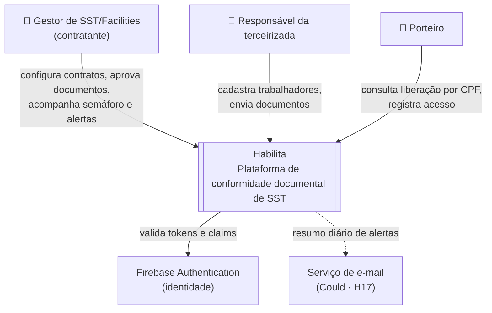
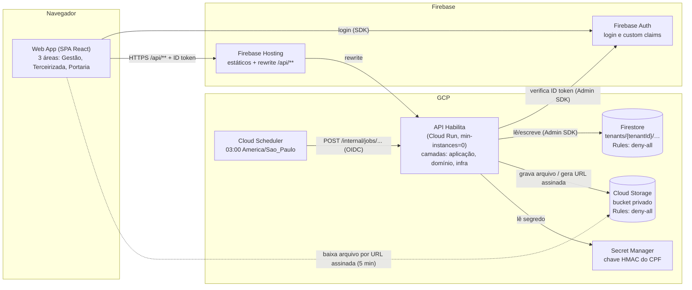
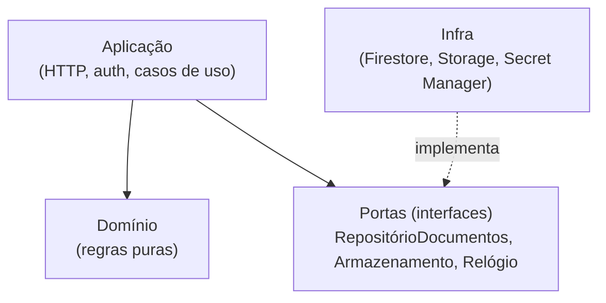
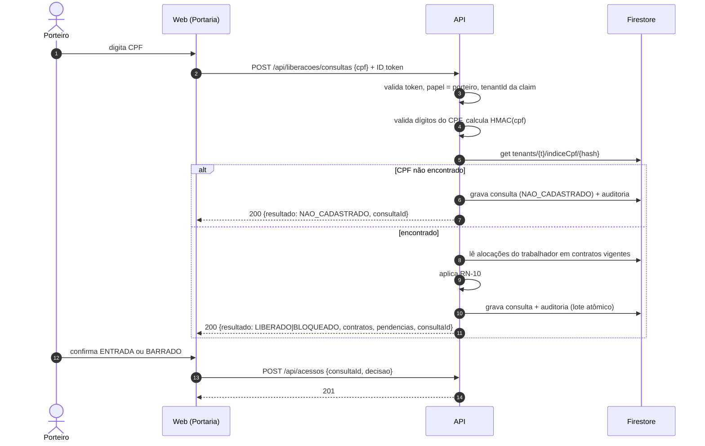
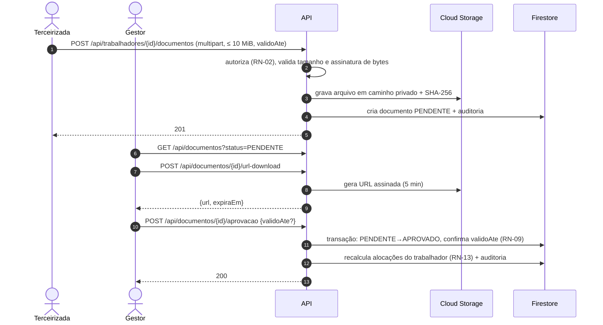
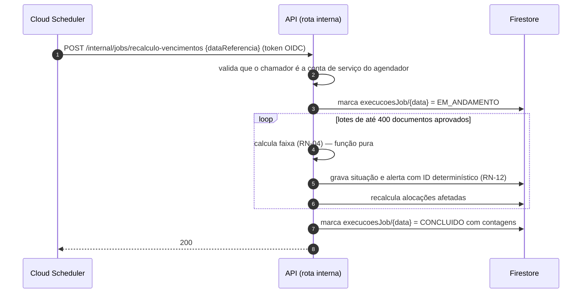

# Arquitetura

| Campo | Valor |
|---|---|
| Status | Rascunho |
| Responsável | Tech Lead |
| Última atualização | 14/10/2026 |
| Notação | Modelo C4 (níveis 1 e 2) e diagramas de sequência em Mermaid |

## 1. Objetivos e restrições que moldam a arquitetura

| Força | Consequência na arquitetura |
|---|---|
| **Isolamento entre clientes** é o principal requisito de segurança | Tenant no caminho dos dados, tenant extraído do token, acesso a dados só pelo backend ([ADR 0002](adr/0002-tenant-autorizacao.md)) |
| **Teto de US$ 50** e uso intermitente | Serviços que escalam a zero (Cloud Run com `min-instances=0`, Firestore e Storage por uso) |
| **9 semanas e equipe pequena** | Monólito modular: uma API, um frontend, um banco. Nada de microsserviços ([ADR 0005](adr/0005-estilo-arquitetural.md)) |
| **Rodar tudo localmente até a Semana 4** | Docker Compose com emuladores do Firebase (Auth, Firestore, Storage) |
| **Resposta rápida na portaria** (p95 ≤ 800 ms) | Semáforo materializado; consulta por chave (hash do CPF) |
| **Documentos com dado de saúde** (ASO) | Bucket privado, download por link temporário, nenhum dado pessoal em log ([ADR 0006](adr/0006-armazenamento-de-documentos.md)) |

## 2. Contexto (C4 nível 1)

## 3. Contêineres (C4 nível 2)

**Regra de ouro:** o navegador **nunca** acessa Firestore ou Storage diretamente. As Security Rules negam tudo; só a API, com credencial de serviço, lê e escreve. Isso concentra autorização em um único lugar testável.

## 4. Camadas da API

A API segue a arquitetura em camadas estudada no lab, com a regra de dependência apontando para o domínio.

| Camada | Responsabilidade | Exemplos no Habilita | Pode depender de |
|---|---|---|---|
| **Apresentação** (web) | Telas por papel, estados de carregando, vazio, erro e sucesso | Painel com semáforo, fila de pendentes, tela de portaria | API (via contrato OpenAPI) |
| **Aplicação** (API) | Rotas HTTP, validação de entrada, autenticação, autorização, orquestração dos casos de uso | `RejeitarDocumento`, `ConsultarLiberacao`, middleware de token/tenant/papel | Domínio, portas de infraestrutura |
| **Domínio** | Regras de negócio puras, sem I/O | Cálculo de faixa (RN-04), semáforo (RN-06), reuso (RN-08), validação de CPF/CNPJ | Nada (100% testável em unidade) |
| **Dados / Infra** | Adaptadores de Firestore, Storage, Secret Manager, relógio, logger | Repositórios por tenant, gerador de URL assinada | SDKs externos |

O domínio não conhece o Firestore. Isso permite testar todas as regras com dados em memória e cumprir a meta de ≥ 80% de cobertura no domínio.

## 5. Fluxos principais

### 5.1 Consulta de liberação na portaria (J5)

### 5.2 Envio e aprovação de documento (J2 e J3)

### 5.3 Recálculo diário (J4)

Detalhes da idempotência em [ADR 0007](adr/0007-recalculo-idempotente.md).

## 6. Como a arquitetura atende os requisitos não funcionais

Os requisitos são definidos em [Requisitos Não Funcionais](../produto/requisitos/nao-funcionais.md). Esta tabela mostra **onde** cada um é atendido e **como** é verificado.

| RNF | Onde a arquitetura atende | Como verificar |
|---|---|---|
| RNF01 · Autorização por tenant e papel | Tenant no caminho, claims no token, Rules deny-all (ADR 0002) | Suíte de isolamento e matriz de autorização no CI |
| RNF02 · Upload seguro | Validação por assinatura de bytes, bucket privado, URL assinada (ADR 0006) | Testes T-UPL |
| RNF03 · Zero vulnerabilidade crítica/alta | Dependências mínimas; varredura no pipeline (ADR 0003) | Varredura de dependências, imagens e segredos |
| RNF04 · p95 leitura ≤ 800 ms / escrita ≤ 1,5 s | Semáforo materializado; consulta por chave (ADR 0007, ADR 0008) | Logs de latência por rota; k6 |
| RNF05 · Cobertura | Domínio puro, sem I/O (ADR 0005) | Relatório de cobertura em `docs/testes/relatorios` |
| RNF06 · Lighthouse ≥ 90 | SPA enxuta no Hosting com CDN | Lighthouse CI |
| RNF07 · Operação | `/healthz`, `/readyz`, logs JSON com `requestId` | Inspeção dos logs; alertas 5xx e p95 |
| RNF08 · Custo | Escala a zero, `max-instances` baixo, paginação | [FinOps](../finops/index.md) |
| RNF09 · Sem dado real em teste e demo | Seed fictício reproduzível | Revisão do seed |
| RNF10 · Disponibilidade na demo | Smoke test pós-deploy; rollback (ADR 0003) | Checklist do Demo Day |
| RNF11 · Nenhum dado pessoal em log | CPF só como HMAC; corpo da rota de portaria não registrado (ADR 0008) | Teste sobre a saída de log |
| RNF12 · Reprodutibilidade | Docker Compose + emuladores | Subida em máquina limpa por outro integrante |
| RNF13 · Portaria no celular | Tela de um campo, cor acompanhada de texto | Revisão de UI e Lighthouse |

## 7. Ambientes

| Ambiente | Quando | Composição | Dados |
|---|---|---|---|
| **Local** | S1 a S4 (e sempre para desenvolvimento) | Docker Compose: web, API, emuladores Auth/Firestore/Storage | Seed fictício reproduzível |
| **Preview** | A partir da S6, por PR | Canal de preview do Hosting + revisão do Cloud Run com tag | Seed fictício |
| **Produção** | A partir da S6, após merge na `main` | Hosting + Cloud Run + Firestore + Storage | Seed fictício para a demo |

## 8. Riscos técnicos

| Risco | Impacto | Mitigação |
|---|---|---|
| **Cold start** do Cloud Run com `min-instances=0` estoura o p95 de 800 ms na primeira consulta | Médio | Medir cedo; imagem pequena; inicialização preguiçosa de SDKs; se necessário, `min-instances=1` só no dia da demo, registrado em ADR e no relatório de custo |
| **Emulador de Storage** pode não reproduzir URLs assinadas como em produção | Médio | *Spike* na S3 para validar; plano B: download servido pela API em modo local, por configuração |
| Consultas *collection group* sem filtro de tenant expõem dados | Alto | Restritas ao job interno; revisão de código obrigatória; teste de isolamento |
| Custo de leituras do Firestore no job diário | Baixo/Médio | Ler só documentos aprovados; lotes; volume de demo pequeno; alerta de orçamento |
| Rota síncrona (SDK `firebase-admin`) declarada como `async def` travar o servidor | Médio | Rotas com SDK síncrono declaradas com `def`; item no checklist de revisão (ADR 0001) |

## 9. Decisões pendentes

| Decisão | ADR | Prazo |
|---|---|---|
| Política de retenção de documentos | A criar | 15/11 |

## Histórico de versões

| Versão | Data | Autor | Alterações |
|---|---|---|---|
| 1.0 | 14/10/2026 | @osamuelleite | Versão inicial, conciliação PO + Tech Lead. Visão da arquitetura em camadas e diagramas de sequência, adaptados à estrutura da PO. |
