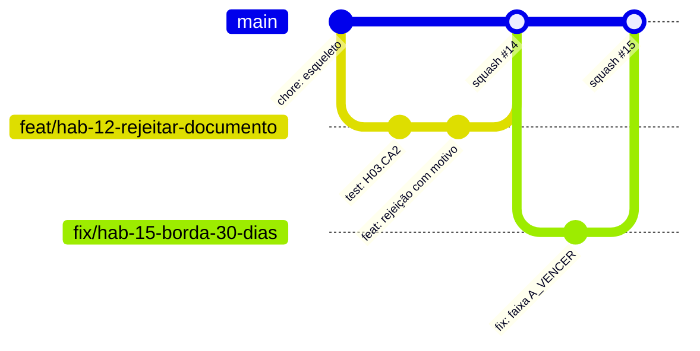

# Como contribuir

| Campo | Valor |
|---|---|
| Status | Rascunho |
| Responsável | Tech Lead (configuração no GitHub: DevOps) |
| Última atualização | 14/10/2026 |

## Regras de documentação (docs-as-code)

- Toda mudança de comportamento, contrato ou infra atualiza a página correspondente **no mesmo PR**.
- Nova decisão relevante → nova ADR em `docs/arquitetura/adr/` e entrada no `mkdocs.yml` ([ADR 0004](../arquitetura/adr/0004-documentacao-mkdocs.md)).
- Página nova = arquivo `.md` **e** linha no `nav:` do `mkdocs.yml`; antes do push, `python -m mkdocs build --strict` sem erro ([Primeiros passos](primeiros-passos.md)).

## Modelo de branches: GitHub Flow

Uma branch principal (`main`), sempre implantável, e uma branch curta por história, integrada por Pull Request.



**Por que não Gitflow:** Gitflow (branches `develop`, `release` e `hotfix`) serve a produtos com versões lançadas em ciclos e várias versões em produção. O Habilita tem uma única versão em produção, deploy contínuo após merge (Caderno CP3) e preview por PR. Branches longas só atrasariam a integração e aumentariam conflitos em 9 semanas.

## Regras da `main` (proteção de branch — Checkpoint 1)

- [ ] Push direto bloqueado para todos, inclusive administradores.
- [ ] Merge só por PR com **1 aprovação** de alguém diferente do autor.
- [ ] Aprovação anulada quando há novo commit.
- [ ] CI obrigatório verde (lint, build e `mkdocs build --strict` no CP1; testes a partir do CP2).
- [ ] Branch atualizada com a `main` antes do merge.
- [ ] Merge por **squash** (um commit por história na `main`).
- [ ] Conversas do PR resolvidas antes do merge.
- [ ] Branch apagada após o merge.

## Nome das branches

`<tipo>/hab-<NN>-<descricao-curta>`

| Tipo | Uso | Exemplo |
|---|---|---|
| `feat` | Nova funcionalidade | `feat/hab-12-rejeitar-documento` |
| `fix` | Correção de defeito | `fix/hab-15-borda-30-dias` |
| `docs` | Só documentação | `docs/adr-0006-armazenamento` |
| `test` | Só testes | `test/hab-20-isolamento-tenant` |
| `chore` | Configuração, dependências, CI | `chore/ci-lint-build` |
| `refactor` | Mudança sem alterar comportamento | `refactor/hab-14-funcao-pura-faixa` |

## Commits: Conventional Commits

```
<tipo>(<escopo>): <resumo no imperativo, até 72 caracteres>

[corpo opcional: o porquê da mudança]

Refs: H03
```

- **Tipos:** `feat`, `fix`, `docs`, `test`, `refactor`, `chore`, `ci`, `perf`, `build`.
- **Escopos sugeridos:** `web`, `api`, `dominio`, `infra`, `docs`, `seed`.
- Exemplos:
  - `feat(api): rejeitar documento exigindo motivo`
  - `test(dominio): cobrir bordas D+29, D+30 e D+31`
  - `docs(adr): registrar decisão de armazenamento`
- Mudança incompatível de contrato: `feat(api)!: ...` e explicação no corpo.

## Pull Requests

- Um PR por história (ou parte dela, se for grande). Ideal: até ~400 linhas alteradas.
- Título no padrão Conventional Commits (vira o commit do squash).
- Template obrigatório: ``.github/PULL_REQUEST_TEMPLATE.md``.
- Revisor responde em até 1 dia útil. PR parado há mais de 2 dias vai para a reunião semanal.
- Rascunho (*draft*) é incentivado para receber feedback cedo.

## CODEOWNERS (Checkpoint 1)

Arquivo `.github/CODEOWNERS` com usuários reais do GitHub da equipe. Modelo (substituir pelos usuários):

```
# Padrão: Tech Lead revisa o que não tiver dono específico
*                          @usuario-tech-lead

# Frontend
/apps/web/                 @usuario-frontend

# Backend e domínio
/apps/api/                 @usuario-backend @usuario-tech-lead

# Contrato da API: frontend e backend precisam concordar
/openapi.yaml              @usuario-backend @usuario-frontend

# Decisões de arquitetura e segurança
/docs/arquitetura/         @usuario-tech-lead
/docs/seguranca/           @usuario-tech-lead

# Produto
/docs/produto/             @usuario-po

# Infra e pipeline
/.github/                  @usuario-devops
/mkdocs.yml                @usuario-po @usuario-tech-lead
/docker-compose.yml        @usuario-devops
```

## Versões e tags

- Cada gate recebe uma tag anotada na `main`: `cp1-fundacao`, `cp2-nucleo`, `cp3-nuvem`, `cp4-estabilizacao`, `v1.0.0-demo-day`.
- Imagens de contêiner usam o SHA do commit como tag; nunca `latest` em produção.
