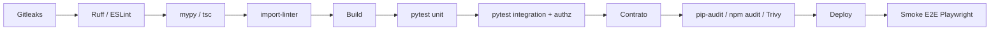

# Qualidade de código, tipagem e validação

| Campo | Valor |
|---|---|
| Responsável | Tech Lead (com QA) |
| Última atualização | 14/10/2026 |
| Relacionados | [ADR 0001](../arquitetura/adr/0001-stack.md), [Estratégia de testes](../testes/estrategia.md), [Segurança](../seguranca/index.md), [DoD](definition-of-done.md) |

Esta página define **quais ferramentas** garantem a qualidade do Habilita, **onde** cada uma roda e **qual meta** ela protege. A estratégia (o que testar e por quê) está na [Estratégia de testes](../testes/estrategia.md); aqui fica o *como*.

## 1. Ferramentas por finalidade

### 1.1 Backend (Python 3.12 + FastAPI)

| Finalidade | Ferramenta | Onde roda | Bloqueia o merge? |
|---|---|---|---|
| Gerenciar dependências e ambiente | **uv**, com `pyproject.toml` e lockfile commitado | Local e CI | — |
| Lint e formatação | **Ruff** (`ruff check` e `ruff format`), incluindo as regras de segurança `S` (equivalentes ao Bandit) | pre-commit e CI | Sim |
| Tipagem estática | **mypy** em modo `strict` (obrigatório no `dominio/`; gradual no resto) | CI | Sim |
| Regra de camadas | **import-linter**: o `dominio/` não importa `infra/` nem FastAPI (ADR 0005) | CI | Sim |
| Testes de unidade e integração | **pytest** + **pytest-cov**; API testada com o `TestClient` do FastAPI (httpx) | CI | Sim |
| Testes com emuladores | pytest contra o Firebase Emulator Suite (Firestore, Auth, Storage) | CI | Sim |
| Testes baseados em propriedades | **Hypothesis** para regras de data (faixas de validade, RN-04) | CI | Sim |
| Testes de contrato | **Schemathesis** contra o `openapi.yaml` | CI | Sim (a partir do CP2) |
| Vulnerabilidades em dependências | **pip-audit** + Dependabot | CI e semanal | Sim para crítica/alta (RNF03) |

### 1.2 Frontend (React + TypeScript)

| Finalidade | Ferramenta | Onde roda | Bloqueia o merge? |
|---|---|---|---|
| Tipagem | **TypeScript** com `strict: true` (`tsc --noEmit`) | CI | Sim |
| Tipos da API | **openapi-typescript**: tipos gerados a partir do `openapi.yaml` (nunca escritos à mão) | CI | Sim, se o arquivo gerado estiver desatualizado |
| Validação de formulários | **Zod**, espelhando os limites do contrato (tamanhos, formatos) | — | — |
| Lint e formatação | **ESLint** + **Prettier** | pre-commit e CI | Sim |
| Testes de componentes | **Vitest** + **Testing Library** (estados carregando, vazio, erro, sucesso) | CI | Sim |
| Vulnerabilidades em dependências | `npm audit` + Dependabot | CI | Sim para crítica/alta |

### 1.3 Ponta a ponta, desempenho e repositório

| Finalidade | Ferramenta | Onde roda | Bloqueia? |
|---|---|---|---|
| E2E das jornadas J1 a J5 | **Playwright** (com **pytest-playwright**, mesma linguagem da API) | Merge na `main` e smoke pós-deploy | Sim (deploy) |
| Desempenho e acessibilidade do frontend | **Lighthouse CI** (meta ≥ 90, RNF06) | Merge na `main` | Sim a partir do CP4 |
| Carga local | **k6** (p95 da portaria ≤ 800 ms, RNF04) | Manual, semanal a partir da S4 | — |
| Segredos no código e no histórico | **Gitleaks** | pre-commit e CI | Sim |
| Vulnerabilidades na imagem | **Trivy** | CI (a partir do CP3) | Sim para crítica/alta |
| Security Rules | **@firebase/rules-unit-testing** (Node, só nos testes das Rules) | CI | Sim |
| Documentação | `mkdocs build --strict` (ADR 0004) | CI | Sim |
| Ganchos locais | **pre-commit** (Ruff, ESLint, Prettier, Gitleaks) | Máquina do dev | — |

> Os testes das Security Rules exigem a biblioteca oficial em JavaScript. É a única parte em Node no lado do backend, isolada em `apps/api/tests/rules/`.

## 2. Tipagem

**Por que tipar:** em Python, tipos não são verificados na execução. O mypy encontra antes do merge erros que só apareceriam em produção (campo inexistente, `None` não tratado, data passada como texto).

| Camada | Regra |
|---|---|
| `dominio/` | mypy `strict` obrigatório; nenhum `Any`; regras puras recebem e devolvem tipos do domínio |
| `aplicacao/` | Modelos Pydantic para toda entrada e saída HTTP; nenhuma rota recebe ou devolve `dict` cru |
| `infra/` | Tipagem nas fronteiras (repositórios); `# type: ignore` só com comentário explicando o motivo |
| Frontend | `strict: true`; tipos da API gerados do contrato; proibido `any` sem comentário |

**Objetos de valor no domínio** (classes imutáveis, `@dataclass(frozen=True)`): `Cpf` (valida dígitos e normaliza), `Cnpj`, `PeriodoVigencia` (`inicio ≤ fim`), `DataValidade`. Um CPF inválido não consegue nem ser criado, então o resto do código não precisa revalidar.

## 3. Validação de campos

A validação acontece em **três camadas**, cada uma com um papel:

| Camada | Ferramenta | O que valida | Exemplo no Habilita |
|---|---|---|---|
| 1 · Navegador | Zod | Experiência do usuário: erro antes de enviar | "Motivo precisa de pelo menos 10 caracteres" |
| 2 · Borda da API | **Pydantic v2** | **Segurança e contrato**: tipo, formato, tamanho, campos permitidos. **É a validação que vale.** | `motivo: str` com 10 a 500 caracteres; `extra="forbid"` |
| 3 · Domínio | Objetos de valor e regras | Regras de negócio que dependem de estado | Só documento `PENDENTE` pode ser rejeitado (409) |

**Regras obrigatórias da camada 2 (Pydantic):**

1. **`extra="forbid"`** em todo modelo de entrada: campo não previsto gera 400. Isso bloqueia *mass assignment*, por exemplo alguém enviar `statusRevisao` ou `tenantId` no corpo.
2. **Limites explícitos** em todo texto e lista (`min_length` e `max_length`, que no Pydantic v2 valem também para listas), iguais aos do `openapi.yaml`.
3. **Validadores próprios** para CPF, CNPJ e datas: `dataEmissao` não pode estar no futuro; `validoAte` não pode ser anterior a `dataEmissao` (RN-09).
4. **Texto normalizado** antes de validar (ex.: remover espaços nas pontas do motivo, RN-03; deixar só os dígitos do CPF).
5. **Modelo de resposta** (`response_model`) em toda rota: a API devolve só os campos declarados. `cpfHash` e o caminho interno do arquivo nunca saem, mesmo que existam no objeto.
6. **Erros de validação** convertidos em Problem Details (RFC 9457) com a lista de campos inválidos, sem expor a mensagem interna do Pydantic.
7. **Upload** validado fora do Pydantic: tamanho máximo de 10 MiB e tipo real pela assinatura de bytes (ADR 0006).

**Contrato primeiro:** o `openapi.yaml` é a fonte. Um teste no CI compara o OpenAPI gerado pelo FastAPI com o arquivo da raiz e falha em caso de divergência; o Schemathesis gera requisições a partir do contrato e verifica se a API responde conforme.

## 4. Organização de testes na API

```
apps/api/
├── src/habilita/<modulo>/{aplicacao,dominio,infra}/
└── tests/
    ├── unit/          # domínio puro, sem emulador (rápido; maior volume)
    ├── integration/   # casos de uso com emuladores Firestore/Storage/Auth
    ├── authz/         # matriz de autorização gerada a partir de x-papeis
    ├── contract/      # Schemathesis + conformidade com openapi.yaml
    ├── rules/         # Security Rules (JavaScript)
    └── e2e/           # Playwright (pytest-playwright)
```

- Nome do teste referencia o critério: `test_h03_ca2_rejeitar_sem_motivo_retorna_400`.
- Marcadores do pytest separam os níveis: `-m unit` roda em segundos e localmente a cada mudança.
- Fixtures criam os dois tenants do seed para os testes de isolamento.

## 5. Metas e gates

| Métrica | Meta | Ferramenta | Gate |
|---|---|---|---|
| Cobertura no domínio | ≥ 80% (RNF05) | pytest-cov | CP4 |
| Cobertura global | ≥ 60% (RNF05) | pytest-cov + Vitest | CP4 |
| Rotas com teste de autorização | 100% (RNF01) | pytest (`authz/`) | CP2 |
| Erros de tipo | 0 no `dominio/` | mypy | CP2 |
| Vulnerabilidades crítica/alta | 0 sem exceção registrada (RNF03) | pip-audit, npm audit, Trivy | CP4 |
| Lighthouse | ≥ 90 (RNF06) | Lighthouse CI | CP4 |
| Segredos expostos | 0 | Gitleaks | CP1 |

## 6. Ordem no pipeline (ADR 0003)



Cada etapa bloqueia a seguinte (Caderno CP4). Unidade e lint rodam primeiro porque são os mais rápidos e pegam a maior parte dos erros.
