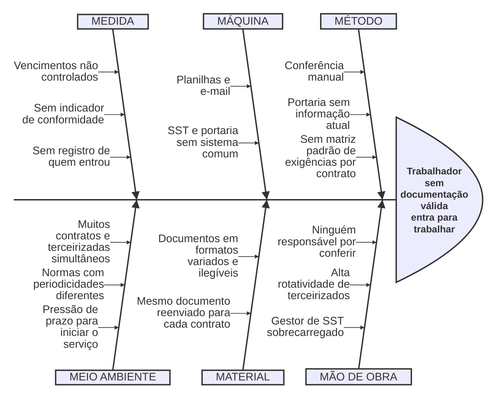

# Ishikawa (causa e efeito)

!!! info "Sobre esta página"
    **Para que serve:** Mostrar as causas do problema, organizadas em categorias. É obrigatório no CP1.

    **O que escrever:** Trocar os exemplos pelas causas que a equipe identificar (de preferência vindas das entrevistas).

    **Prazo:** CP1 · 18/10

**Efeito (problema):** trabalhador sem documentação válida entra para trabalhar.

!!! note "Categorias"
    O Guia do Checkpoint 1 pede os **6M**: Método, Máquina, Mão de obra, Material, Medida e Meio ambiente, com pelo menos uma causa em cada grupo (ou "não se aplica"). Os exemplos do rascunho original (Pessoas, Processo, Ferramentas, Dados, Comunicação) foram mantidos como causas dentro do grupo 6M correspondente, marcados com ★.

## Causas por categoria

Todas são **hipóteses** até as entrevistas. A última coluna liga cada causa à pergunta do [roteiro de entrevista](roteiro-entrevista.md) que a testa.

| 6M | Causa (hipótese) | Origem | Como o Habilita responde | Pergunta |
|---|---|---|---|---|
| **Método** | Conferência manual | Rascunho PO ★ (Processo) | Cálculo automático de vencimento e semáforo | P3, P4 |
| | Portaria sem informação atual | Rascunho PO ★ (Comunicação) | Consulta de liberação por CPF em tempo real (J5) | P7 |
| | Sem matriz padrão de exigências por contrato | Tech Lead | Matriz de exigências por contrato (J1) | P5 |
| **Máquina** | Planilhas e e-mail | Rascunho PO ★ (Ferramentas) | Cadastro estruturado e alertas (J4) | P3 |
| | SST e portaria sem sistema comum | Tech Lead | Mesmo semáforo alimenta painel e portaria | P7 |
| **Mão de obra** | Ninguém responsável por conferir | Rascunho PO ★ (Pessoas) | Fila única de pendentes com aprovador registrado (J3) | P6 |
| | Alta rotatividade de terceirizados | Tech Lead | Cadastro rápido e reuso de documentos | P2 |
| | Gestor de SST sobrecarregado | Tech Lead | Alertas automáticos; menos conferência repetida | P3, P6 |
| **Material** | Documentos em formatos variados e ilegíveis | Tech Lead | Upload restrito a PDF, JPEG e PNG, com aprovação humana | P6 |
| | Mesmo documento reenviado para cada contrato | Tech Lead | Reuso automático entre contratos | P5 |
| **Medida** | Vencimentos não controlados | Rascunho PO ★ (Dados) | Recálculo diário idempotente (J4) | P4 |
| | Sem indicador de conformidade | Tech Lead | Semáforo por trabalhador e contrato | P8 |
| | Sem registro de quem entrou | Tech Lead | Registro de acesso e trilha de auditoria (J5) | P7 |
| **Meio ambiente** | Muitos contratos e terceirizadas simultâneos | Tech Lead | Multicontrato com visão consolidada | P1 |
| | Normas com periodicidades diferentes (ex.: NR-10 e NR-35 bienais) | Tech Lead | Validade por documento e prazo padrão por tipo | P5 |
| | Pressão de prazo para iniciar o serviço | Tech Lead | Reuso reduz o tempo de habilitação | P10 |

## Para o gate

- [x] Cada um dos 6 grupos tem pelo menos uma causa.
- [ ] Redesenhar no formato espinha de peixe (Miro, draw.io ou Excalidraw) e salvar a imagem em `docs/produto/estrategia/ishikawa.png`.
- [ ] Revisar após as entrevistas: marcar causas confirmadas e descartadas.
