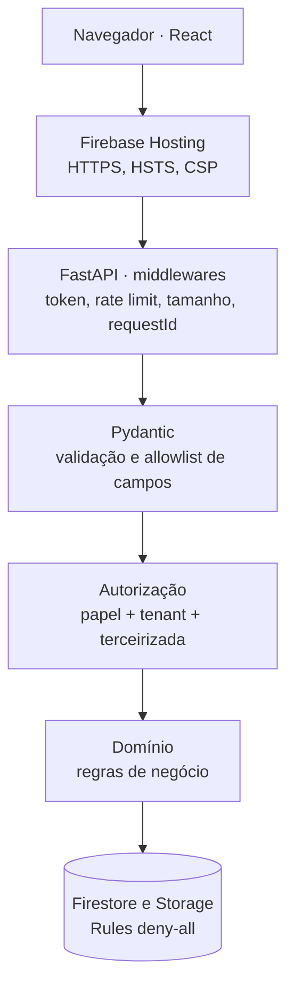

# Segurança

| Campo | Valor |
|---|---|
| Status | Rascunho |
| Responsável | Tech Lead (revisão: QA) |
| Última atualização | 14/10/2026 |
| Método | STRIDE sobre os fluxos da [Visão Arquitetural](../arquitetura/index.md) + inventário de dados (LGPD) + checklist de controles |

## 1. Ativos a proteger

| Ativo | Por que importa |
|---|---|
| Documentos de SST (arquivos) | Contêm dado de saúde (ASO) e dados pessoais |
| Identidade dos trabalhadores (nome, CPF) | Dado pessoal; o CPF é a chave de consulta da portaria |
| Isolamento entre clientes | Vazamento entre tenants destrói a confiança no produto |
| Decisões de aprovação e registros de acesso | Evidência em auditoria e incidentes |
| Credenciais (tokens, chave HMAC, conta de serviço) | Abrem todo o resto |
| Orçamento de nuvem | Abuso pode estourar o teto de US$ 50 |

## 2. Fronteiras de confiança

1. **Navegador ↔ API**: tudo que vem do navegador é não confiável (corpo, query, cabeçalhos, arquivos).
2. **API ↔ Firebase/GCP**: credencial de serviço com privilégio mínimo.
3. **Cloud Scheduler ↔ rota interna**: só a conta de serviço do agendador.
4. **Tenant ↔ tenant**: fronteira lógica dentro do mesmo banco (ADR 0002).

## 3. Ameaças (STRIDE)

| ID | Categoria | Ameaça | Controle | Verificação | Gate |
|---|---|---|---|---|---|
| **AM-01** | Information disclosure | Usuário do tenant A lê dados do tenant B (ID adivinhado, filtro esquecido, *collection group*) | Tenant no caminho; tenant só da claim; 404 fora do escopo; *collection group* restrito ao job (ADR 0002) | T-ISO-01 a 05 | CP1 (escrito), CP2 (passando) |
| **AM-02** | Elevation of privilege | Terceirizada ou porteiro executa ação de gestor; terceirizada X vê dados da Y | RBAC por rota (`x-papeis`) + escopo por `terceirizadaId` (ADR 0002) | Matriz de autorização (100% das rotas) | CP2 |
| **AM-03** | Information disclosure | CPF vaza por URL, log, resposta ou banco | POST com CPF no corpo; HMAC + máscara; logs sem corpo dessa rota (ADR 0008) | Teste de log sem 11 dígitos seguidos | CP2 |
| **AM-04** | Tampering / Elevation | Upload de arquivo malicioso (HTML ou script disfarçado de PDF) servido a outro usuário | Validação por assinatura de bytes; só PDF/JPEG/PNG; download como anexo; nome original fora do caminho (ADR 0006) | Testes de arquivo com extensão falsa | CP2 |
| **AM-05** | Information disclosure | Link de documento compartilhado ou reaproveitado | URL assinada de 5 min, gerada só após autorização; bucket privado; Rules deny-all | Teste de URL expirada | CP2 |
| **AM-06** | Information disclosure / DoS | Varredura de CPFs na portaria; força bruta no login | Rate limit na consulta (30/min por usuário); proteção de força bruta do Firebase Auth; auditoria de consultas | Teste de 429 | CP2 |
| **AM-07** | Spoofing | Chamada forjada à rota do job | Token OIDC validado (emissor, audiência, conta de serviço) | Teste de 401/403 sem OIDC | CP3 |
| **AM-08** | Repudiation | Gestor nega ter aprovado um documento | Auditoria append-only no mesmo lote da operação (ADR 0009) | H20.CA1 | CP2 |
| **AM-09** | Tampering | Mass assignment: cliente envia `statusRevisao`, `tenantId` ou `terceirizadaId` no corpo | Esquemas com `additionalProperties: false`; mapeamento explícito de campos; tenant e terceirizada sempre da claim | Testes de contrato com campos extras | CP2 |
| **AM-10** | Information disclosure | Segredo commitado no Git ou exposto em log de erro | `.env` fora do Git, `.env.example` sem valores; varredura de segredos no CI; erros sem stack trace para o cliente | Gitleaks no CI | CP1 (`.env.example`), CP4 (varredura) |
| **AM-11** | Tampering | Dependência maliciosa (typosquatting) | Revisão de toda dependência nova no PR; lockfile commitado; varredura de dependências | `npm audit`/`pip-audit` + Dependabot | CP4 |
| **AM-12** | DoS (financeiro) | Abuso que estoura o orçamento (requisições em massa, uploads repetidos) | `max-instances` baixo; rate limit; limite de tamanho; alertas de orçamento 50/80/100% | Alertas configurados (print) | CP1 |

## 4. Inventário de dados pessoais (LGPD)

| Dado | Titular | Onde fica | Finalidade | Proteção | Quem acessa |
|---|---|---|---|---|---|
| Nome do trabalhador | Trabalhador | Firestore | Identificar na portaria e no painel | Isolamento por tenant | Gestor, terceirizada (próprios), porteiro (na consulta) |
| CPF | Trabalhador | Firestore, **somente** HMAC + máscara | Localizar o trabalhador e garantir unicidade | HMAC com chave no Secret Manager; nunca em log ou URL | Ninguém vê o CPF completo após o cadastro |
| Arquivos de documentos (incl. ASO — dado de saúde) | Trabalhador | Cloud Storage privado | Comprovar aptidão | Bucket privado, URL assinada de 5 min, auditoria de cada link gerado | Gestor; terceirizada (próprios) |
| Datas de emissão e validade | Trabalhador | Firestore | Calcular vencimento | Isolamento por tenant | Gestor, terceirizada (próprios) |
| E-mail dos usuários do sistema | Usuários | Firebase Auth | Login | Gerenciado pelo Firebase Auth | Administração (seed) |
| Registros de consulta e acesso | Trabalhador e porteiro | Firestore | Controle de acesso e auditoria | Append-only, sem CPF | Gestor |

**Princípios aplicados:** finalidade (só verificar aptidão), necessidade (sem endereço, telefone, foto, data de nascimento), segurança (controles acima), não discriminação (o sistema não interpreta o conteúdo do ASO, apenas registra o documento e a validade aprovada pelo gestor).

**Dados de teste e demo:** exclusivamente fictícios. CPFs de teste gerados com dígito verificador válido por algoritmo, nunca coletados de pessoas reais. Documentos de exemplo são PDFs gerados com o texto "DOCUMENTO FICTÍCIO".

## 5. Controles por camada da stack

Onde cada controle vive na stack da [ADR 0001](../arquitetura/adr/0001-stack.md) e qual ameaça ele trata. Uma requisição atravessa as camadas de cima para baixo; cada uma barra um tipo de abuso antes que ele chegue à seguinte.

| Camada | Controle | Como é implementado | Ameaça |
|---|---|---|---|
| **Firebase Hosting** | HTTPS obrigatório e HSTS | Padrão do Hosting + cabeçalho `Strict-Transport-Security` | Interceptação |
| | Cabeçalhos de segurança | `firebase.json`: `Content-Security-Policy`, `X-Content-Type-Options: nosniff`, `Referrer-Policy`, `frame-ancestors 'none'` | XSS, clickjacking |
| | Mesma origem para web e API | Rewrite `/api/**` → Cloud Run; sem CORS em produção (em desenvolvimento, CORS só para `localhost`) | Chamadas de outros sites |
| **Borda da API (middlewares FastAPI)** | Autenticação | `firebase-admin` verifica o ID token (assinatura, expiração, emissor) em toda rota protegida | AM-02 |
| | **Rate limit** | Ver seção 5.1 | AM-06, AM-12 |
| | Limite de tamanho do corpo | JSON até 64 KiB; upload até 10 MiB, verificado em *streaming* antes de ler tudo (o Cloud Run aceita até 32 MiB por requisição HTTP/1) | AM-12 |
| | Rastreabilidade | `X-Request-Id` em toda resposta e em todo log | AM-08 |
| | Respostas não armazenáveis | `Cache-Control: no-store` em respostas com dado pessoal | AM-03 |
| | Timeouts | Timeout por requisição no Cloud Run (proposta: 30 s) e em chamadas a serviços externos | AM-12 |
| **Validação (Pydantic)** | Tipos, formatos, tamanhos, `extra="forbid"` | Ver [Qualidade, seção 3](../engenharia/qualidade.md) | AM-09 |
| | Upload pelo conteúdo real | Assinatura de bytes de PDF, JPEG e PNG (ADR 0006) | AM-04 |
| **Autorização** | Papel por rota + escopo do recurso | Dependência do FastAPI que lê `x-papeis` e as claims; 403 ou 404 (ADR 0002) | AM-01, AM-02 |
| **Domínio** | Regras de estado | Ex.: entrada só com consulta `LIBERADO` de até 10 min (RN-11) | Fraude na portaria |
| **Dados** | Rules deny-all; CPF só como HMAC; bucket privado; URL assinada de 5 min | ADR 0002, 0006, 0008 | AM-01, AM-03, AM-05 |
| | Auditoria append-only | ADR 0009 | AM-08 |
| **Erros e logs** | Erros em Problem Details, sem *stack trace* | *Exception handlers* globais do FastAPI | AM-10 |
| | Logs JSON sem dado pessoal | Logger estruturado com filtro que mascara CPF e tokens; corpo da rota de portaria nunca é registrado | AM-03, RNF11 |
| **Segredos e configuração** | Nada no código | `pydantic-settings` lê variáveis de ambiente; na nuvem, Secret Manager exposto como variável do Cloud Run; local, `.env` fora do Git | AM-10 |
| **Dependências e CI** | Varreduras | Gitleaks, Ruff (regras `S`), pip-audit, npm audit, Trivy, Dependabot ([Qualidade](../engenharia/qualidade.md)) | AM-10, AM-11 |
| **Infraestrutura** | Menor privilégio | Conta de serviço da API só com os papéis necessários; WIF no CI; rota do job só com OIDC do agendador | AM-07 |
| | Teto de escala | `max-instances` baixo (ADR 0003) | AM-12 |

### 5.1 Rate limit

| Rota | Limite por usuário (proposta) | Motivo |
|---|---|---|
| `POST /liberacoes/consultas` | 30 por minuto | Impedir varredura de CPFs (ADR 0008) |
| Upload de documento | 20 por minuto | Custo de armazenamento e processamento |
| Demais escritas (`POST`, `PUT`) | 60 por minuto | Abuso e erro de cliente em laço |
| Leituras (`GET`) | 120 por minuto | Proteger orçamento de leituras do Firestore |
| Sem autenticação | 20 por minuto por IP | Requisições que só recebem 401 |

- **Implementação:** biblioteca **slowapi** (baseada em `limits`), aplicada como dependência ou decorador nas rotas do FastAPI.
- **Chave:** o `uid` do token, não o IP. Uma portaria inteira pode sair pelo mesmo IP, e o limite por IP bloquearia todos os porteiros juntos.
- **Resposta:** `429 Too Many Requests` com cabeçalho `Retry-After` e corpo em Problem Details (já previsto no `openapi.yaml`).
- **Limitação aceita no MVP:** o contador fica **em memória, por instância**. Com `max-instances=3`, o limite real pode chegar a 3 vezes o valor configurado. Um contador compartilhado exigiria Redis (Memorystore, com custo fixo mensal incompatível com o teto de US$ 50) ou escritas no Firestore a cada requisição (custo e latência). Reavaliar se o produto sair do lab.
- **Login:** a autenticação acontece no Firebase Auth, fora da API, que já tem proteção própria contra abuso. Avaliar no CP3 o **Firebase App Check** para garantir que só o frontend oficial chame a API.
- **Teste:** T-RL-01 e T-RL-02 na [Estratégia de testes](../testes/estrategia.md).

## 6. Checklist de controles

Base: checklist de 24 pontos para sistemas feitos com IA, adaptado para Firebase/GCP (onde o original fala em RLS de Postgres, aqui valem as Security Rules e o isolamento na API).

### Segredos
- [ ] Nenhuma chave no código; tudo via variáveis de ambiente ou Secret Manager.
- [ ] `.env` no `.gitignore`; `.env.example` só com nomes e valores fictícios. **(CP1)**
- [ ] Nenhum segredo no histórico do Git (Gitleaks no CI). **(CP4)**
- [ ] Credencial de serviço só no backend; o frontend usa apenas a configuração pública do Firebase.
- [ ] Sem chave JSON de conta de serviço: Workload Identity Federation no CI. **(CP3)**

### Dados e acesso
- [ ] Security Rules **deny-all** no Firestore e no Storage, com teste no emulador. **(CP2)**
- [ ] Tenant e terceirizada sempre da claim; nunca da requisição.
- [ ] Menor privilégio por papel (matriz de autorização testada em 100% das rotas). **(CP2)**
- [ ] Allowlist de campos em toda entrada (`additionalProperties: false`). **(CP2)**
- [ ] Validação de entrada em toda rota (tamanho, formato, dígitos de CPF e CNPJ). **(CP2)**
- [ ] Consultas ao Firestore construídas por API tipada, nunca por concatenação de texto do usuário.

### Autenticação e sessão
- [ ] ID token verificado no backend em toda rota protegida (assinatura, expiração, emissor).
- [ ] Nenhuma tela com dado pessoal sem autenticação.
- [ ] Token no cabeçalho `Authorization`, nunca em URL nem em `localStorage` além do que o SDK do Firebase gerencia.
- [ ] Senhas gerenciadas pelo Firebase Auth (o Habilita nunca armazena senha).

### Infraestrutura e tráfego
- [ ] HTTPS em tudo (Hosting e Cloud Run já forçam).
- [ ] Cabeçalhos de segurança no Hosting: `Content-Security-Policy`, `X-Content-Type-Options: nosniff`, `Referrer-Policy`, `frame-ancestors 'none'` (ou `X-Frame-Options: DENY`), `Strict-Transport-Security`. **(CP3)**
- [ ] Rate limit na consulta de portaria e nas rotas de escrita. **(CP2)**
- [ ] Proteção de login contra força bruta (recursos do Firebase Auth). **(CP3)**
- [ ] Upload restrito: 10 MiB, PDF/JPEG/PNG por assinatura de bytes. **(CP2)**
- [ ] Respostas enxutas: nunca devolver campos que a tela não usa (ex.: caminho interno do arquivo, `cpfHash`).
- [ ] Erros ao cliente em Problem Details, sem stack trace; detalhe só no log interno, sem dados pessoais.

### Dependências
- [ ] Toda dependência nova justificada no PR; conferir nome exato no registro oficial (typosquatting).
- [ ] Lockfile commitado; varredura de dependências e imagens no CI. **(CP4)**

### Processo
- [ ] Antes de cada gate: rodar a suíte de isolamento e de autorização e anexar o resultado aos [Relatórios](../testes/relatorios/index.md).
- [ ] Rodar o plugin de revisão de segurança antes do Checkpoint 4 e registrar achados no backlog.
