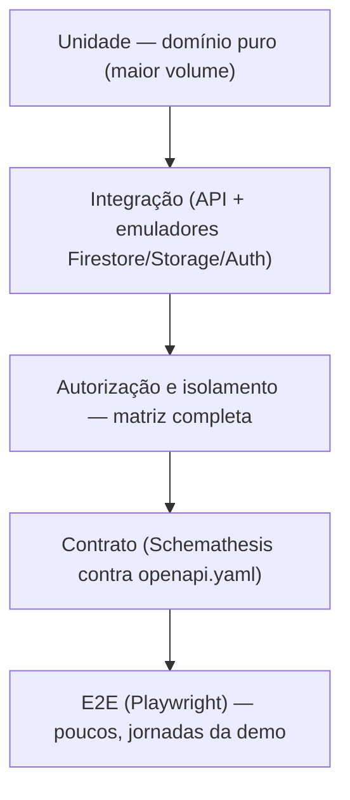

# Estratégia de testes

| Campo | Valor |
|---|---|
| Status | Rascunho (ferramentas dependem do ADR 0001) |
| Responsável | QA (revisão: Tech Lead) |
| Última atualização | 14/10/2026 |

## 1. Objetivo

Provar, com evidência reproduzível, que o Habilita (1) cumpre os critérios de aceite do [Backlog](../produto/requisitos/historias-backlog.md), (2) **nunca** mostra dados de um cliente para outro e (3) acerta as bordas das regras de vencimento. Sem plano, testa-se o que é fácil; este plano prioriza o que é **arriscado**.

## 2. Prioridades por risco

| Risco | Impacto se falhar | Onde testamos com mais força |
|---|---|---|
| Vazamento entre tenants ou papéis | Crítico (fim da confiança, LGPD) | Isolamento + matriz de autorização, 100% das rotas |
| Semáforo errado na borda do vencimento | Alto (trabalhador inapto liberado) | Unidade com EP/BVA no domínio |
| Job duplicando alertas ou corrompendo estado | Alto | Integração no emulador (idempotência) |
| Upload malicioso ou acima do limite | Alto | Unidade + integração com arquivos de teste |
| Contrato frontend ↔ API divergente | Médio | Testes de contrato contra o OpenAPI |
| Lentidão na portaria | Médio | Carga local + medição de p95 |

## 3. Níveis de teste

| Nível | O que cobre | Ferramenta (detalhes em [Qualidade e ferramentas](../engenharia/qualidade.md)) | Quando roda | Marco |
|---|---|---|---|---|
| **Unidade** | Regras puras: faixas (RN-04), semáforo (RN-06), reuso (RN-08), `validoAte` (RN-09), liberação (RN-10), validação de CPF/CNPJ, motivo de rejeição | pytest + Hypothesis | Todo PR | CP2 |
| **Integração** | Casos de uso com Firestore e Storage reais do emulador; job idempotente; auditoria no mesmo lote | pytest + Firebase Emulator Suite | Todo PR | CP2 |
| **Autorização e isolamento** | Matriz rota × papel; tenant e terceirizada errados; token ausente, inválido e expirado | pytest (`tests/authz/`), gerado a partir da matriz abaixo | Todo PR | CP1 (escrito) / CP2 |
| **Security Rules** | Negação de leitura e escrita direta em Firestore e Storage | `@firebase/rules-unit-testing` | Todo PR | CP2 |
| **Contrato** | Respostas conformes ao `openapi.yaml`; rejeição de campos extras; OpenAPI gerado pelo FastAPI igual ao da raiz | Schemathesis + teste de conformidade | Todo PR | CP2 |
| **Falhas e timeouts** | Erro do Storage no upload; falha no meio do job; dependência lenta | pytest com dublês de falha | Todo PR | CP4 |
| **Carga local** | p95 da consulta de portaria e das listas | k6 | Manual, semanal a partir da S4 | CP4 |
| **E2E** | Jornadas J1 a J5 e cena da demo (reuso + portaria) | Playwright (pytest-playwright) | Merge na `main`; smoke pós-deploy | CP4 |
| **Frontend** | Componentes com estados carregando, vazio, erro, sucesso | Vitest + Testing Library | Todo PR | CP2 |
| **Desempenho do frontend** | Lighthouse ≥ 90 | Lighthouse CI | Merge na `main` | CP4 |

## 4. Particionamento e valor-limite (EP/BVA)

Técnicas obrigatórias pelo Caderno. Cada tabela vira testes parametrizados.

### 4.1 Faixa de validade (RN-04), data de referência D

| Caso | `validoAte` | Classe | Situação esperada |
|---|---|---|---|
| T-VAL-01 | D − 365 | Vencido (classe) | `VENCIDO` |
| T-VAL-02 | D − 1 | Borda inferior de vencido | `VENCIDO` |
| T-VAL-03 | D | Borda: último dia válido | `A_VENCER` |
| T-VAL-04 | D + 1 | Dentro de "a vencer" | `A_VENCER` |
| T-VAL-05 | D + 29 | Borda interna | `A_VENCER` |
| T-VAL-06 | D + 30 | Borda superior de "a vencer" | `A_VENCER` |
| T-VAL-07 | D + 31 | Primeira data `VALIDO` | `VALIDO` |
| T-VAL-08 | D + 365 | Válido (classe) | `VALIDO` |
| T-VAL-09 | D + 30, D = 28/02/2027 | Virada de mês curto | `A_VENCER` |
| T-VAL-10 | D às 23:59 e 00:01 de Brasília (UTC diferente) | Fuso horário | Mesma D em `America/Sao_Paulo` |

### 4.2 Semáforo (RN-06), contrato exigindo ASO e NR-35

| Caso | ASO | NR-35 | Esperado |
|---|---|---|---|
| T-SEM-01 | `VALIDO` | `VALIDO` | Verde |
| T-SEM-02 | `VALIDO` | `A_VENCER` | Amarelo |
| T-SEM-03 | `A_VENCER` | `A_VENCER` | Amarelo |
| T-SEM-04 | `VALIDO` | `VENCIDO` | Vermelho |
| T-SEM-05 | `VALIDO` | ausente | Vermelho |
| T-SEM-06 | `VALIDO` | só `PENDENTE` | Vermelho |
| T-SEM-07 | `VALIDO` | `REJEITADO` + outro `APROVADO VALIDO` | Verde (RN-06; Q1 em aberto) |
| T-SEM-08 | Dois ASOs aprovados: um `VENCIDO`, outro `VALIDO` | `VALIDO` | Verde (vale o de maior `validoAte`, RN-05) |

### 4.3 Upload (H02)

| Caso | Entrada | Esperado |
|---|---|---|
| T-UPL-01 | PDF válido pequeno (cerca de 1 KB) | 201 |
| T-UPL-02 | PDF de 10.485.760 bytes | 201 |
| T-UPL-03 | PDF de 10.485.761 bytes | 413 |
| T-UPL-04 | Arquivo HTML renomeado para `.pdf` | 415 |
| T-UPL-05 | PNG com `Content-Type: application/pdf` | 201 (vale a assinatura de bytes; gravado como PNG) |
| T-UPL-06 | Arquivo vazio (0 bytes) | 400 |
| T-UPL-07 | `dataEmissao` = amanhã | 400 |
| T-UPL-08 | `validoAte` ausente | 400 |
| T-UPL-09 | `validoAte` anterior à `dataEmissao` | 400 |
| T-UPL-10 | `validoAte` já vencida (ontem) | 201; documento entra `PENDENTE` e, se aprovado, fica `VENCIDO` |

### 4.4 Motivo de rejeição (RN-03)

| Caso | Motivo | Esperado |
|---|---|---|
| T-REJ-01 | ausente | 400 |
| T-REJ-02 | `"          "` (só espaços) | 400 |
| T-REJ-03 | 9 caracteres | 400 |
| T-REJ-04 | 10 caracteres | 200 |
| T-REJ-05 | 500 caracteres | 200 |
| T-REJ-06 | 501 caracteres | 400 |
| T-REJ-07 | `"   10 chars   "` → 10 após remover espaços das pontas | 200 |

### 4.5 CPF (H02, H04)

| Caso | Entrada | Esperado |
|---|---|---|
| T-CPF-01 | CPF fictício com dígitos válidos, sem máscara | Aceito |
| T-CPF-02 | Mesmo CPF com máscara | Aceito e equivalente ao T-CPF-01 |
| T-CPF-03 | Dígito verificador errado | 400 |
| T-CPF-04 | `111.111.111-11` | 400 |
| T-CPF-05 | 10 ou 12 dígitos | 400 |

### 4.6 Registro de acesso (RN-11)

| Caso | Consulta | Idade | Decisão | Esperado |
|---|---|---|---|---|
| T-ACE-01 | `LIBERADO` | 9 min 59 s | `ENTRADA` | 201 |
| T-ACE-02 | `LIBERADO` | 10 min 01 s | `ENTRADA` | 409 |
| T-ACE-03 | `BLOQUEADO` | 1 min | `ENTRADA` | 422 |
| T-ACE-04 | `BLOQUEADO` | 1 min | `BARRADO` | 201 |
| T-ACE-05 | consulta já usada | 1 min | qualquer | 409 |

### 4.7 Limites de requisição (rate limit)

| Caso | Cenário | Esperado |
|---|---|---|
| T-RL-01 | Porteiro faz a 31ª consulta de liberação no mesmo minuto | 429 com `Retry-After`; a 30ª ainda responde 200 |
| T-RL-02 | Porteiro A atinge o limite; porteiro B do mesmo tenant consulta em seguida | B recebe 200 (o limite é por usuário, não por IP) |

## 5. Testes de isolamento de tenant

**Exigido no Checkpoint 1: escrito, mesmo falhando.** Massa de dados: tenants `A` e `B`, cada um com um gestor, uma terceirizada (usuário próprio), um porteiro, um contrato, um trabalhador e um documento.

| ID | Cenário | Esperado |
|---|---|---|
| T-ISO-01 | Gestor de A faz `GET /contratos/{id de B}`, `/trabalhadores/{id de B}` e `/documentos/{id de B}` | 404 em todos, corpo sem dados de B |
| T-ISO-02 | Gestor de A lista contratos, trabalhadores, documentos, alertas e auditoria | Nenhum item de B |
| T-ISO-03 | Gestor de A envia `tenantId: "B"` no corpo, na query e em cabeçalho ao criar contrato | Contrato criado em A; nada criado em B |
| T-ISO-04 | Porteiro de A consulta CPF de trabalhador que só existe em B | `NAO_CADASTRADO`, sem nome nem ids de B |
| T-ISO-05 | Usuário `terceirizada` X de A pede trabalhador da terceirizada Y de A | 404 |
| T-ISO-06 | Cliente autenticado de A tenta ler `tenants/B/...` direto no Firestore e no Storage | Negado pelas Rules |
| T-ISO-07 | Gestor de A gera URL de download de documento de B | 404 |

## 6. Matriz de autorização

Gerada a partir da extensão `x-papeis` do [OpenAPI](../arquitetura/api.md). Cada célula é um caso de teste: ✅ = acesso permitido (resposta 2xx ou de validação), **403** = papel sem permissão, **401** = sem token. Para cada linha também se testa **token expirado** e **token com assinatura inválida** (401) e, nas rotas com `{id}`, **recurso de outro tenant** (404).

| Rota | gestor | terceirizada | porteiro | sem token |
|---|:-:|:-:|:-:|:-:|
| `GET /me` | ✅ | ✅ | ✅ | 401 |
| `GET /terceirizadas` | ✅ | 403 | 403 | 401 |
| `POST /terceirizadas` | ✅ | 403 | 403 | 401 |
| `GET /tipos-documento` | ✅ | ✅ | 403 | 401 |
| `POST /tipos-documento` | ✅ | 403 | 403 | 401 |
| `GET /contratos` | ✅ | ✅ | 403 | 401 |
| `POST /contratos` | ✅ | 403 | 403 | 401 |
| `GET /contratos/{contratoId}` | ✅ | ✅ | 403 | 401 |
| `PUT /contratos/{contratoId}/exigencias` | ✅ | 403 | 403 | 401 |
| `POST /contratos/{contratoId}/alocacoes` | ✅ | ✅ | 403 | 401 |
| `GET /contratos/{contratoId}/conformidade` | ✅ | ✅ | 403 | 401 |
| `GET /trabalhadores` | ✅ | ✅ | 403 | 401 |
| `POST /trabalhadores` | ✅ | ✅ | 403 | 401 |
| `GET /trabalhadores/{trabalhadorId}` | ✅ | ✅ | 403 | 401 |
| `POST /trabalhadores/{trabalhadorId}/documentos` | ✅ | ✅ | 403 | 401 |
| `GET /documentos` | ✅ | 403 | 403 | 401 |
| `GET /documentos/{documentoId}` | ✅ | ✅ | 403 | 401 |
| `POST /documentos/{documentoId}/url-download` | ✅ | ✅ | 403 | 401 |
| `POST /documentos/{documentoId}/aprovacao` | ✅ | 403 | 403 | 401 |
| `POST /documentos/{documentoId}/rejeicao` | ✅ | 403 | 403 | 401 |
| `GET /alertas` | ✅ | 403 | 403 | 401 |
| `POST /alertas/{alertaId}/leitura` | ✅ | 403 | 403 | 401 |
| `POST /liberacoes/consultas` | ✅ | 403 | ✅ | 401 |
| `POST /acessos` | 403 | 403 | ✅ | 401 |
| `GET /auditoria` | ✅ | 403 | 403 | 401 |

Rotas fora da matriz: `/healthz` e `/readyz` (públicas) e `/internal/jobs/recalculo-vencimentos` (só OIDC do agendador; testar que ID token de qualquer papel recebe 403 e ausência de token recebe 401).

Total: **25 rotas × (3 papéis + sem token + expirado + assinatura inválida) = 150 casos**, mais os de outro tenant. A suíte deve ser **gerada** a partir do OpenAPI para não ficar desatualizada quando uma rota for adicionada.

## 7. Metas de qualidade (Checkpoint 4)

| Métrica | Meta |
|---|---|
| Cobertura de linhas no domínio | ≥ 80% |
| Cobertura global | ≥ 60% |
| Rotas com teste de autorização | 100% |
| Vulnerabilidades críticas ou altas | 0 sem exceção registrada |
| Lighthouse | ≥ 90 |
| p95 de leitura / escrita | ≤ 800 ms / ≤ 1,5 s |
| Bugs críticos abertos no Demo Day | 0 |

## 8. Dados de teste

- **Seed reproduzível** (`seed/`): mesmos dados a cada execução, criados por script, com dois tenants para isolamento.
- **Dados fictícios apenas**: CPFs e CNPJs gerados por algoritmo com dígitos válidos; PDFs com a marca "DOCUMENTO FICTÍCIO".
- **Relógio injetado**: testes passam `dataReferencia` explícita; nenhum teste depende da data real.
- Cada teste de integração começa com o emulador limpo.

## 9. Rastreabilidade

A partir do CP2, manter a [Matriz de rastreabilidade](matriz.md) (colunas: Requisito · Critério de aceite · Teste · Resultado · PR). Regra da DoD: **todo teste novo referencia um critério de aceite** (no nome ou em comentário, ex.: `H03.CA2`).

## 10. Relatórios e evidências

| Artefato | Local | Marco |
|---|---|---|
| Matriz de rastreabilidade | [matriz.md](matriz.md) | CP2 |
| Primeiro relatório de testes, JUnit, cobertura, Lighthouse | [Relatórios](relatorios/index.md) (gerados pelo CI, versionados por gate) | CP2 e CP4 |
| Resultado de carga (k6) | [Relatórios](relatorios/index.md) | CP4 |

## 11. Severidade de defeitos

| Severidade | Definição | Exemplo | Regra |
|---|---|---|---|
| **Crítica** | Vazamento de dados, liberação indevida, perda de dados | Porteiro de A vê trabalhador de B | Bloqueia merge e deploy; corrigir imediatamente |
| **Alta** | Jornada principal quebrada sem contorno | Aprovação não atualiza o semáforo | Corrigir na sprint corrente |
| **Média** | Funciona com contorno | Filtro da fila não persiste | Priorizar no backlog |
| **Baixa** | Cosmético | Texto desalinhado | Backlog |
